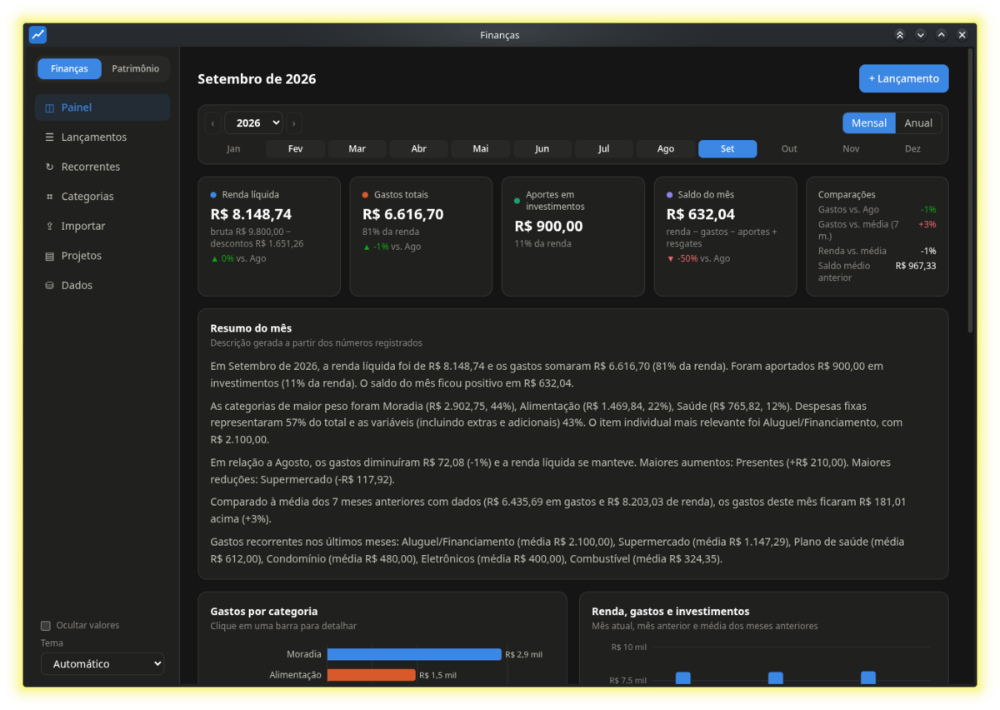
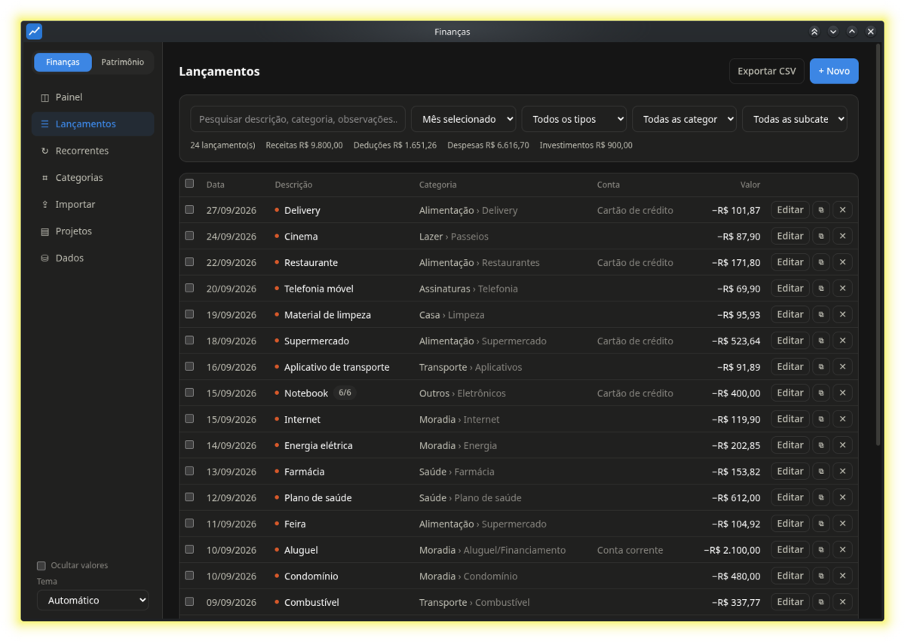
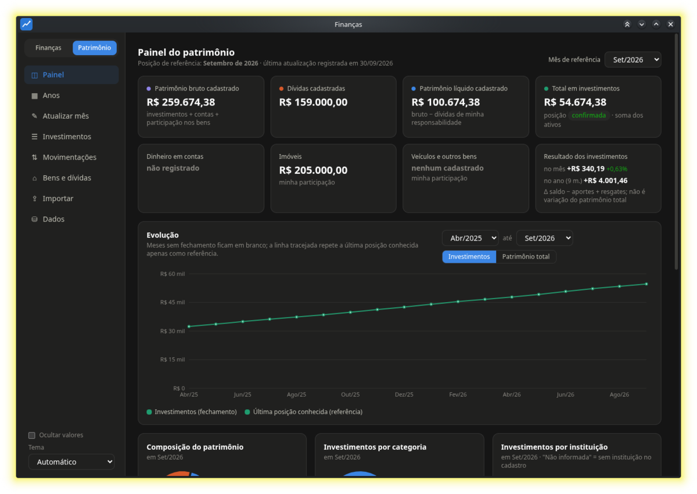
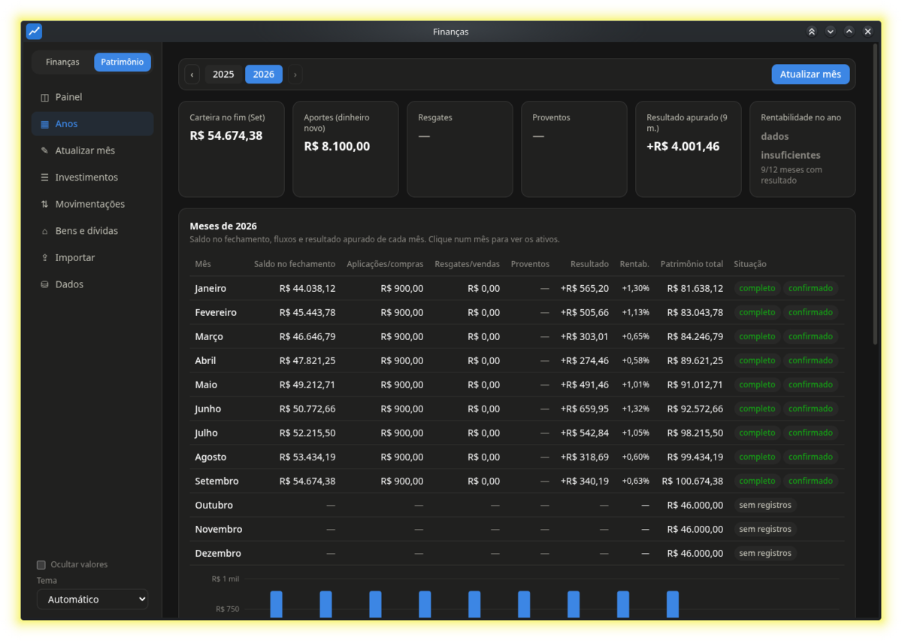

# Finanças — finanças pessoais e patrimônio

Aplicativo de computador (Linux e Windows) que reúne em uma janela duas áreas que costumam viver em planilhas separadas:

- **Finanças** — fluxo de caixa mês a mês: renda, gastos, investimentos e saldo; lançamentos com categorias, contas, compras parceladas e competência separada da data; despesas recorrentes; projetos (custos de uma reforma, de um carro, de uma dívida) fora do fluxo mensal; importação de extratos e faturas em CSV/XLSX.
- **Patrimônio** — posições mensais de cada investimento, patrimônio total (investimentos + contas + bens − dívidas), aportes, proventos, e o resultado apurado de cada mês e de cada ano.

**Tudo fica na sua máquina.** Não existe servidor, conta, nuvem ou telemetria: nenhuma porta de rede é aberta e nada é enviado para lugar nenhum. Os dados ficam em dois arquivos SQLite que você pode copiar, versionar ou abrir com qualquer ferramenta de banco de dados.



<details>
<summary>Mais telas</summary>

**Lançamentos** — filtros por período, tipo, categoria e subcategoria; edição de categoria em lote; compras parceladas marcadas com a parcela.



**Patrimônio** — posição consolidada do mês e evolução da carteira.



**Patrimônio por ano** — mês a mês: saldo, aportes, resultado e rentabilidade.



</details>

> As imagens usam a base de exemplo gerada por `scripts/dados-exemplo.ts` — valores inventados.

---

## Instalação

### Opção A — baixar o instalador pronto

Pegue o arquivo do seu sistema na página de [**Releases**](https://github.com/jszutkoski-alt/Plataforma_financas/releases):

- **Linux** — `Finanças-x.y.z.AppImage`: dê permissão de execução (`chmod +x`) e abra com dois cliques; não instala nada no sistema. Ou `financas-desktop_x.y.z_amd64.deb` em Debian/Ubuntu/Mint: `sudo apt install ./financas-desktop_*.deb`.
- **Windows** — `Finanças Setup x.y.z.exe` (instalador) ou a versão portátil, que roda sem instalar.

> Na primeira instalação no Windows o SmartScreen mostra "aplicativo não reconhecido", porque o executável não é assinado por um certificado pago. Clique em **Mais informações → Executar assim mesmo**.

### Opção B — gerar os instaladores você mesmo

É preciso ter o [Node.js](https://nodejs.org) 22.13 ou mais novo.

```bash
git clone https://github.com/jszutkoski-alt/Plataforma_financas.git
cd Plataforma_financas
npm install
```

**Linux** — gera AppImage e `.deb` em `release/`:

```bash
npm run dist:linux
```

- **AppImage**: dê permissão de execução (`chmod +x Finanças-*.AppImage`) e abra com dois cliques. Não instala nada no sistema.
- **`.deb`** (Debian, Ubuntu, Mint): `sudo apt install ./financas-desktop_*.deb`.

**Windows** — gera instalador NSIS e uma versão portátil em `release/`:

```bash
npm run dist:win
```

Esse comando precisa rodar **no Windows**; gerar o instalador do Windows a partir do Linux depende de Wine e costuma falhar. O jeito prático é deixar o GitHub Actions fazer isso: o workflow [`.github/workflows/instaladores.yml`](.github/workflows/instaladores.yml) monta os três pacotes (AppImage, `.deb` e `.exe`) a cada tag `v*`, anexando-os à Release — e também pode ser disparado à mão em **Actions → Instaladores → Run workflow**.

Para publicar uma nova versão:

```bash
npm version patch          # ou minor / major
git push --follow-tags     # a tag dispara o workflow
```

### Opção C — rodar direto do código

Útil para experimentar ou desenvolver:

```bash
npm install
npm start      # compila e abre o aplicativo
```

Não há dependências nativas para compilar: o SQLite é o módulo `node:sqlite`, embutido no próprio Node/Electron.

---

## Primeiros passos

1. Abra o aplicativo. O banco é criado vazio, com um conjunto inicial de categorias (Moradia, Alimentação, Transporte, Salário, Aportes…) que você pode renomear, remover ou ampliar.
2. Em **Finanças → Lançamentos → + Novo**, registre entradas e saídas; ou use **Importar** para ler um extrato do banco ou a fatura do cartão em CSV/XLSX, relacionando as colunas do arquivo aos campos do sistema.
3. Em **Patrimônio → Investimentos**, cadastre seus ativos e, a cada mês, informe as posições em **Atualizar mês**.
4. Faça um backup em **Dados → Baixar backup (JSON)** de tempos em tempos.

Meses sem dados aparecem em branco: o programa não estima nem preenche valores que você não informou.

---

## Onde ficam os dados

| Sistema | Pasta |
|---|---|
| Linux | `~/.config/Finanças/dados/` |
| Windows | `%APPDATA%\Finanças\dados\` |

Dentro dela: `financas.db`, `patrimonio.db` e `backups/`.

**Backup.** Na tela **Dados** de cada seção:

- *Baixar backup (JSON)* — formato completo, usado para levar os dados a outro computador (lá, use **Restaurar**);
- *Copiar arquivo .db* — cópia do banco na pasta `backups/`;
- exportações em CSV de qualquer tabela.

O diálogo de salvar é o do próprio sistema: você escolhe a pasta.

**Vindo das versões anteriores.** Se existirem bancos dos aplicativos antigos em `~/financas/data` e `~/patrimonio/data`, eles são copiados para a pasta de dados na primeira execução, com `VACUUM INTO` — os arquivos originais não são alterados.

---

## Arquitetura

```
electron/   main.ts (janela, IPC, migração dos bancos), preload.ts (única ponte com a interface)
core/       financas/ e patrimonio/: db.ts (SQLite) + api.ts (operações). Sem HTTP.
shared/     tipos e cálculos puros, compartilhados com a interface
src/        interface React: Shell.tsx (casca comum) + financas/ e patrimonio/
recursos/   ícone do aplicativo
```

A interface roda sem acesso a Node: o `preload.ts` expõe apenas `chamar(canal, carga)` — restrito aos prefixos `fin:` e `pat:` — além de salvar arquivo e abrir pasta. Cada operação do núcleo é uma função comum; foi assim que o servidor HTTP local deixou de existir.

Como as duas seções vivem no mesmo processo, a integração entre elas é chamada de função direta: o aporte líquido do mês pode ser trazido dos lançamentos de investimento/resgate do Finanças, e uma aplicação ou resgate com dinheiro externo registrada no Patrimônio gera o lançamento de caixa correspondente. Aplicações nunca viram despesa, nem resgates viram renda.

**Tecnologias**: Electron 44, React 19, Vite 8, Tailwind 4, Recharts 3, TypeScript e `node:sqlite`.

---

## Desenvolvimento

```bash
npm run dev        # Vite com recarga automática + Electron
npm test           # 20 testes do núcleo e dos cálculos
npm run typecheck  # interface e processo principal
npm run build      # compila interface (dist/) e processo principal (dist-electron/)
```

Os testes usam bancos em memória e dados inventados — nenhum dado real é necessário para rodá-los.

Para experimentar o aplicativo com uma base cheia (a mesma das capturas acima), gere dados fictícios em uma pasta separada:

```bash
mkdir -p /tmp/demo/dados
FINANCAS_DB=/tmp/demo/dados/financas.db PATRIMONIO_DB=/tmp/demo/dados/patrimonio.db node scripts/dados-exemplo.ts
npm run build && npx electron . --user-data-dir=/tmp/demo
```

O `--user-data-dir` faz o aplicativo usar esse perfil separado: seus dados de verdade não são tocados.

---

## Privacidade

O projeto nasceu de planilhas pessoais e foi deliberadamente separado delas: não há dados reais, exemplos com valores verdadeiros nem histórico de ninguém neste repositório. Bancos de dados (`*.db`) estão no `.gitignore` e não devem ser commitados.

## Licença

[MIT](LICENSE). Sem garantia de espécie alguma: confira seus números antes de tomar decisões com base neles.
